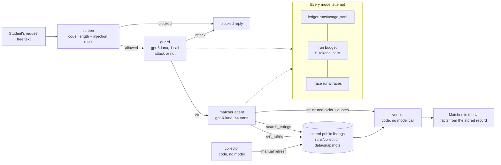

# Beyond Your Circle — architecture (draft, problem 4)

Status: draft for the report's "The agents" section. It matched the code as of problem 4 and the
real run `r_b79bfbda45ad` (evidence/q04.md); updated 2026-10-26 for the participation rule (G-11), the
summary-count check, the ledger's legacy-row skip and the follow-up review fixes (issues 1–12, 14).
The final report needs a rendered diagram image.

## One request, end to end



ASCII fallback:

```
request -> [screen: code] -> [guard: gpt-6-luna x1] -> [matcher: gpt-6-luna, tools] -> [verifier: code] -> UI
                                                        |  search_listings / get_listing
                                                        v
                                    stored listings (collector output, cached or committed snapshot)
every model attempt -> ledger (usage, cost, mode live/mock, served model) + run budget caps + trace event
                       (stats skip legacy rows without a "mode" field: old placeholder history)
```

## Components

| Step | Kind | Model calls | Tools / inputs | Output | Why this design |
|---|---|---|---|---|---|
| screen | code | 0 | user text | allow / block, findings | Cheap first line against oversized or obvious injection text |
| guard | gpt-6-luna | 1 | user text (spotlighted) | `is_attack`, category | Catches paraphrased attacks the rules miss; short prompt, 1 call |
| matcher | gpt-6-luna agent | typically 3 (max 4) | `search_listings`, `get_listing` (untrusted output, spotlighted) | `Recommendations`: understood request, picks with `fit`, `why`, `interaction` (+ quote), `exploration_link` (+ quote), `evidence_quotes`, summary, follow-up question | The only step that needs language understanding: turning a purpose into search terms and explaining fit |
| verifier | code | 0 | matcher output + the run's listing session | kept / excluded / dropped picks with status (match, conditional, exploratory, excluded), verified quotes, facts from the store, `counts`, `headline`, reconciled summary | Fabrication and stale/unavailable picks are caught deterministically; no model can “approve” itself |
| collector | code | 0 | allowlisted public pages | stored records + snapshots | Data comes from real pages with provenance, independent of the model |

Retired from the placeholder: the `researcher` and LLM `verifier` agents. Their work is now done by
deterministic tools (retrieval) and code (verification), which saves roughly four model calls per
request and makes checks reproducible. There is no delegation between model agents.

## Rules added on 2026-10-26 (conditions, summary counts, ledger)

- **Who may take part (G-11, `app/domain/conditions.py`).** "Open to <named group>" (Yale students,
  the Yale community, graduate students ...) is `met` only if the user's own words place them in that
  group, otherwise `to_confirm` (Check first); it is never `not_met`, because "open to X" does not say
  others are turned away. Truly public wording ("open to the public", "everyone is welcome") stays
  `met`. "Undergraduate" no longer counts as "graduate". Eligibility wording that no specific check
  models (eligible, restricted to, must be a ..., by invitation ...) becomes `to_confirm`, never judged.
- **Who may take part, follow-up review (issues 1–7, same file and `app/discover.py`).** (1) A short
  quote from another check ("in-person", "open to all") no longer hides a restriction in the same
  sentence; (2) a narrower unit (undergraduates, Yale College, one school) is `met` only if the
  identity names it too (SOM = School of Management); (3) "open to all <group>" (SOM students, New
  Haven residents ...) is a named group, public only when it ends there or goes on with ages, levels,
  comers or "interested"; (4) negated wording ("not open to the public") is never read as open; (5)
  each eligibility text is searched on its own, so a quote never runs into the next text; (6) the
  catch-all ignores credits ("eligible for CME credit"), sizes in words and speaker affiliation; (7)
  "undergraduate" counts as a student identity, and Browse and Find share one "open to all" pattern.
  Issues 1–6 only add `met` or `to_confirm`. Issue 7 can also exclude: an undergraduate now counts as
  a student, so an existing "... only" rule applies ("Faculty only." with "Yale undergraduate" was
  `to_confirm`, now `not_met`, Not a fit). Offline check: 0 of 1,131
  record × profile evaluations on the 11 stored listings and the manual case records changed against
  the code before this round, and Browse's open/check lists are unchanged for all 11 listings.
- **Summary vs cards (`app/domain/verify.py`).** `code_counts()` counts the final cards; `headline()`
  states them in a code-built sentence; `reconcile_summary()` removes AI summary sentences whose stated
  count disagrees with the cards (the model writes its summary before the checks) and records them in
  `verification.summary_sentences_removed`. If no sentence is left, the orchestrator shows the
  headline. The matcher prompt no longer asks the model to state how many picks it made. Follow-up
  review (issues 8–12): "match" as a verb ("both match your interest") is not a count; the size of the
  searched pool ("among the 11 stored listings") is not a result count; a wrong count is still caught
  through commas and up to five describing words; the sentence split does not break after "e.g.",
  "i.e.", "Dr.", "Mr.", "Ms.", "Prof."; a summary that is only whitespace falls back to the headline,
  never to raw JSON. On the 11 saved traces with checked output the result is unchanged: 4 summaries
  trimmed, 7 untouched (q06 §10).
- **Wording (issue 14).** The matcher prompt's role line, the `search_listings` description and the
  "ongoing" section label now say events, classes and ongoing programs instead of communities
  (old and new text in `AI_prompts.md`); the saved traces used the earlier text.
- **Ledger (`app/ledger.py`).** Rows without a `mode` field (written before the Q4 metering gate by the
  placeholder app) are counted and skipped on load, so `/api/stats` and the Usage tab show only this
  project; `/api/stats` reports them as `legacy_rows_excluded`.

## Tool permissions (least privilege)

| Agent | Allowed tools | Not allowed |
|---|---|---|
| guard | none | everything |
| matcher | `search_listings`, `get_listing` (read-only over stored records) | network, files, registration, messaging, any write |

The matcher cannot fetch the web; only the collector does, outside the model loop.

## Hand-offs and data contracts

1. screen → guard → matcher: the user text (spotlighted as data if the rules flagged it).
2. matcher → tools: JSON arguments validated by strict schemas; results are wrapped as untrusted data.
3. matcher → verifier: `Recommendations` JSON (strict schema, `app/domain/models.py`).
4. verifier → UI: `picks[]` with `card` built from the stored record (`app/discover.py`), `excluded[]`,
   `dropped[]`, `also_read[]`, `counts{}`, `headline`, the reconciled `summary`, `verification{}`.

## Caps (per run)

`RUN_BUDGET_USD=0.05`, `RUN_TOKEN_CAP=250000`, `DAILY_BUDGET_USD=2.00`, `MAX_MODEL_CALLS_PER_RUN=12`
(every attempt, including guard and retries), `LLM_MAX_RETRIES=1`, matcher `max_steps=4`,
`MAX_TOOL_CALLS_PER_RUN=30`, `MAX_OUTPUT_TOKENS=4000`, `RUN_TIMEOUT_S=180` (whole run, guard + agent),
`LLM_TIMEOUT_S=90` (one model call).

**Interest words (G-18, 2026-10-26).** Browse, the `search_listings` tool and the verifier's relevance check share `term_in` (`app/discover.py`): a whole word in any case, or a 2-4 letter word as the capitalised end of a compound ("GeoAI", "ArcGIS"), checked case-sensitively.
