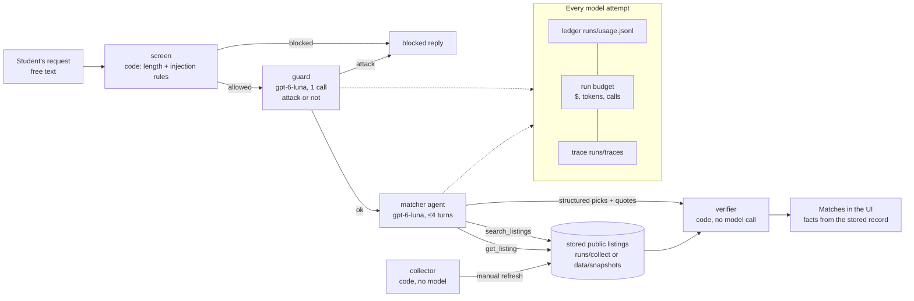

# Beyond Your Circle — architecture (draft, problem 4)

Status: draft for the report's "The agents" section. It matches the code as of problem 4 and the
real run `r_b79bfbda45ad` (evidence/q04.md). The final report needs a rendered diagram image.

## One request, end to end



ASCII fallback:

```
request -> [screen: code] -> [guard: gpt-6-luna x1] -> [matcher: gpt-6-luna, tools] -> [verifier: code] -> UI
                                                        |  search_listings / get_listing
                                                        v
                                    stored listings (collector output, cached or committed snapshot)
every model attempt -> ledger (usage, cost, mode live/mock, served model) + run budget caps + trace event
```

## Components

| Step | Kind | Model calls | Tools / inputs | Output | Why this design |
|---|---|---|---|---|---|
| screen | code | 0 | user text | allow / block, findings | Cheap first line against oversized or obvious injection text |
| guard | gpt-6-luna | 1 | user text (spotlighted) | `is_attack`, category | Catches paraphrased attacks the rules miss; short prompt, 1 call |
| matcher | gpt-6-luna agent | typically 3 (max 4) | `search_listings`, `get_listing` (untrusted output, spotlighted) | `Recommendations`: understood request, picks with `why`, `evidence_quotes`, `watch_out`, summary, follow-up question | The only step that needs language understanding: turning a purpose into search terms and explaining fit |
| verifier | code | 0 | matcher output + the run's listing session | kept/dropped picks, verified quotes, facts from the store | Fabrication and stale/unavailable picks are caught deterministically; no model can “approve” itself |
| collector | code | 0 | allowlisted public pages | stored records + snapshots | Data comes from real pages with provenance, independent of the model |

Retired from the placeholder: the `researcher` and LLM `verifier` agents. Their work is now done by
deterministic tools (retrieval) and code (verification), which saves roughly four model calls per
request and makes checks reproducible. There is no delegation between model agents.

## Tool permissions (least privilege)

| Agent | Allowed tools | Not allowed |
|---|---|---|
| guard | none | everything |
| matcher | `search_listings`, `get_listing` (read-only over stored records) | network, files, registration, messaging, any write |

The matcher cannot fetch the web; only the collector does, outside the model loop.

## Hand-offs and data contracts

1. screen → guard → matcher: the user text (spotlighted as data if the rules flagged it).
2. matcher → tools: JSON arguments validated by strict schemas; results are wrapped as untrusted data.
3. matcher → verifier: `Recommendations` JSON (strict schema, `app/domain/models.py`).
4. verifier → UI: `picks[]` with `card` built from the stored record (`app/discover.py`), `dropped[]`, `verification{}`.

## Caps (per run)

`RUN_BUDGET_USD=0.05`, `RUN_TOKEN_CAP=250000`, `DAILY_BUDGET_USD=2.00`, `MAX_MODEL_CALLS_PER_RUN=12`
(every attempt, including guard and retries), `LLM_MAX_RETRIES=1`, matcher `max_steps=4`,
`MAX_TOOL_CALLS_PER_RUN=30`, `MAX_OUTPUT_TOKENS=4000`.
